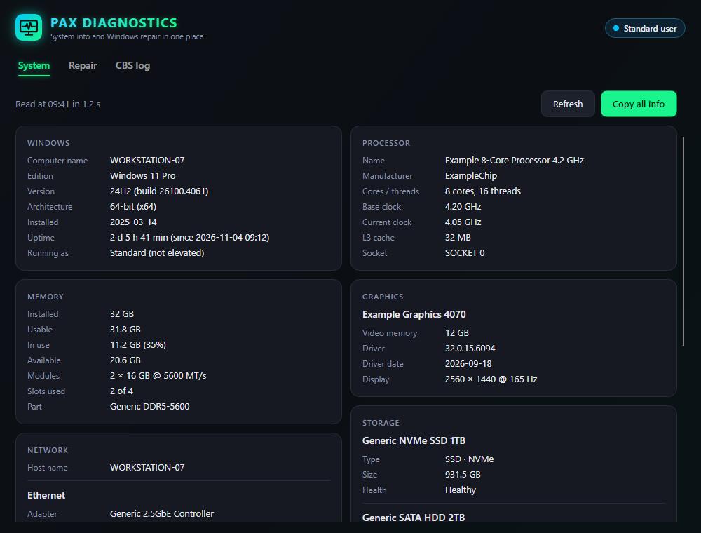
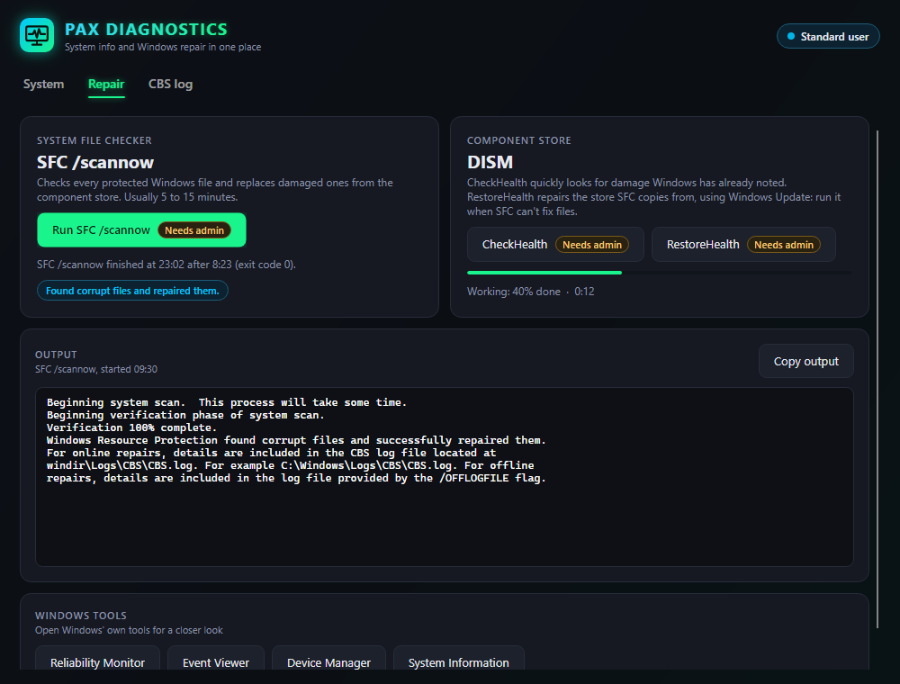
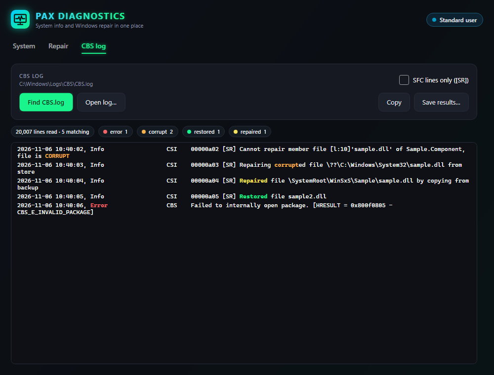

# PAX Diagnostics

**Windows diagnostics in one window.** See what's in a PC at a glance (Windows version, processor, memory, graphics, disks, network and motherboard), run **SFC** and **DISM** with live progress, and pull the errors and repairs out of the CBS log without scrolling through a hundred thousand lines.

<p align="center">
  
</p>

## Features

- **System information as cards.** Windows edition, version and build, install date, **uptime**; processor, cores, threads and clocks; memory in use, modules and slots; **graphics card**, video memory, driver and display mode; disks with SSD/HDD, NVMe/SATA and **Windows' health status**, plus free space per drive; network adapters with speed, MAC, IP, gateway and DNS; system and board maker, BIOS version and date, UEFI and Secure Boot.
- **Copy all info** puts the whole lot on the clipboard as plain text, ready for a support ticket or forum post.
- **SFC /scannow** with live progress: the percentage, the elapsed time, everything SFC prints, and a plain-language verdict at the end (nothing found, repaired, couldn't fix, repair pending).
- **DISM CheckHealth and RestoreHealth** next to SFC, with the same live progress and verdict. RestoreHealth is the usual next step when SFC can't fix files.
- **CBS log filter.** *Find CBS.log* opens Windows' servicing log straight away (no need to know where it lives), or *Open log…* a copy from another PC. Only lines mentioning **error**, **corrupt**, **restored** or **repaired** are listed, with those words coloured and counted. *SFC lines only* narrows it to SFC's own `[SR]` entries. **Copy** or **Save results…** to a text file. The log is read while Windows still has it open, and after an SFC or RestoreHealth run it's read for you.
- **Shortcuts to Windows' own tools:** Reliability Monitor, Event Viewer, Device Manager and System Information.
- **Opens as a normal user.** Only SFC and DISM need administrator rights. Their buttons say **Needs admin**; click one and PAX Diagnostics asks Windows for permission, reopens as administrator and starts that tool straight away. Say No to the prompt and nothing happens apart from a note explaining why.
- **Never freezes.** Reading the hardware, running the tools and filtering the log all happen in the background.

| Repair | CBS log |
| --- | --- |
|  |  |

## Supported systems

| System | Status | Notes |
| --- | --- | --- |
| Windows 11, x64 | **Tested** | |
| Windows 10, x64 | Should work, untested | Uses the same WMI classes, SFC and DISM. |
| Windows on Arm | No download | May build from source with `-r win-arm64`; untested. |
| Linux, macOS | **Not supported** | SFC, DISM, WMI and the CBS log are Windows-only. |

## Install (Windows)

**From PAX Toolkit:** turn on PAX Diagnostics in **[PAX Toolkit](https://github.com/joshpack/PaxToolkit)** and it's downloaded and kept up to date for you.

**By hand:**

1. Install the **[.NET 10 Runtime](https://dotnet.microsoft.com/download/dotnet/10.0)** (x64) if you don't have it. The plain ".NET Runtime" is enough; the ".NET Desktop Runtime" includes it, so that works too.
2. Download **`PaxDiagnostics-1.0.0-win-x64.zip`** from **[the latest release](https://github.com/joshpack/Pax_Diagnostics/releases/latest)**.
3. Unzip it somewhere permanent, for example `%USERPROFILE%\Apps\PaxDiagnostics`.
4. Run `PaxDiagnostics.exe`. It opens without administrator rights.

The exe isn't code-signed, so SmartScreen may warn the first time: choose **More info → Run anyway**.

## Using it

- **System** fills in by itself a second after the window opens. **Refresh** reads everything again; **Copy all info** copies it. A card that couldn't be read says why instead of staying blank.
- **Repair → Run SFC /scannow.** As a standard user, Windows asks for permission first and the app reopens as administrator (the header then says *Administrator*). SFC usually takes 5 to 15 minutes; DISM RestoreHealth can take longer and needs an internet connection. Closing the window while one runs asks you to confirm, because the tool carries on without you seeing the result.
- **CBS log → Find CBS.log** reads `C:\Windows\Logs\CBS\CBS.log`. When a log has more than 5,000 matching lines, the list shows the newest 5,000; Copy and Save always include all of them.

### What the SFC verdicts mean

| Verdict | Next step |
| --- | --- |
| No integrity violations found | Nothing to do. |
| Found corrupt files and repaired them | Restart Windows. |
| Found corrupt files it couldn't fix | Run DISM RestoreHealth, then SFC again. |
| A repair is pending | Restart Windows, then run it again. |
| Couldn't run the scan | Try again after a restart, or from Safe Mode. |

## Command line

| Option | What it does |
| --- | --- |
| `--tool sfc`, `--tool dism-check`, `--tool dism-restore` | Open on the Repair tab and start that tool (only when running as administrator) |
| `--self-test <folder>` | Diagnostics, see below |
| `--self-test <folder> --sample` | The same, with made-up data in the window, for screenshots |
| `--write-icon <file.ico\|file.png>` | Build step: writes the app icon |

## Self-test

```bat
PaxDiagnostics.exe --self-test C:\Temp\pax-test
```

Writes `report.txt` into that folder: what each system information section returned (and which came back empty), a check of the CBS log filter on a made-up `CBS.log` it writes into the folder (also while that file is held open, and while it's locked), a read-only pass over the real CBS log, decoding of recorded SFC and DISM output, the verdicts, and the elevation check. **SFC and DISM are never run.** It also saves `system.png`, `repair.png` and `cbs-log.png`, pictures of each tab drawn off-screen, so nothing appears on your screen. The exit code is 0 when every check passed. Without `--sample` the report and pictures contain your real hardware details.

## Build from source

Windows with the [.NET 10 SDK](https://dotnet.microsoft.com/download/dotnet/10.0):

```bash
git clone https://github.com/joshpack/Pax_Diagnostics.git
cd Pax_Diagnostics
dotnet run
dotnet publish -c Release -r win-x64 --self-contained false -p:DebugType=none -o publish/win-x64
```

The version comes from `<Version>` in `PaxDiagnostics.csproj`. For a copy that doesn't need the .NET Runtime installed, use `--self-contained true` (a bigger download). After changing the icon drawing, run `PaxDiagnostics.exe --write-icon Assets\PaxDiagnostics.ico` and `--write-icon docs\icon.png`, then build again so the exe picks it up.

## Code layout

| Path | What's there |
| --- | --- |
| `Program.cs` | Start-up and the command-line options |
| `App.axaml(.cs)` | Theme, and choosing between the window and the self-test |
| `Views/MainWindow.axaml(.cs)` | The window: System, Repair and CBS log tabs |
| `Diagnostics/SystemInfo.cs` | Reading the hardware and Windows details (WMI, registry, .NET), plus the made-up sample |
| `Diagnostics/RepairTools.cs` | Running SFC and DISM, decoding their output, progress and verdicts |
| `Diagnostics/CbsLog.cs` | Finding, reading, filtering and saving the CBS log |
| `Platform/Elevation.cs` | Checking for administrator rights and restarting elevated |
| `AppIcon.cs` | The app icon, drawn in code |
| `SelfTest.cs` | `--self-test` |
| `docs/screenshots/` | The pictures in this file (made-up data) |

Built with [Avalonia](https://avaloniaui.net/) 12 on .NET 10.
